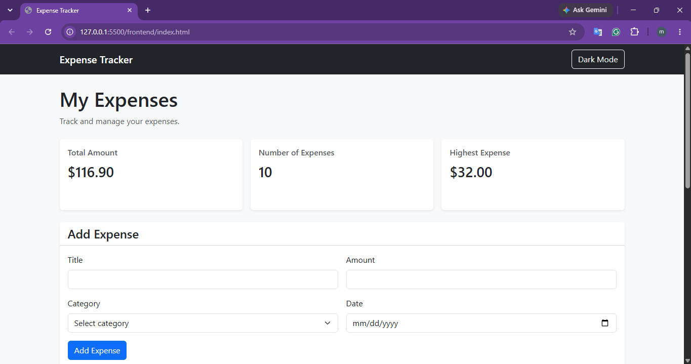
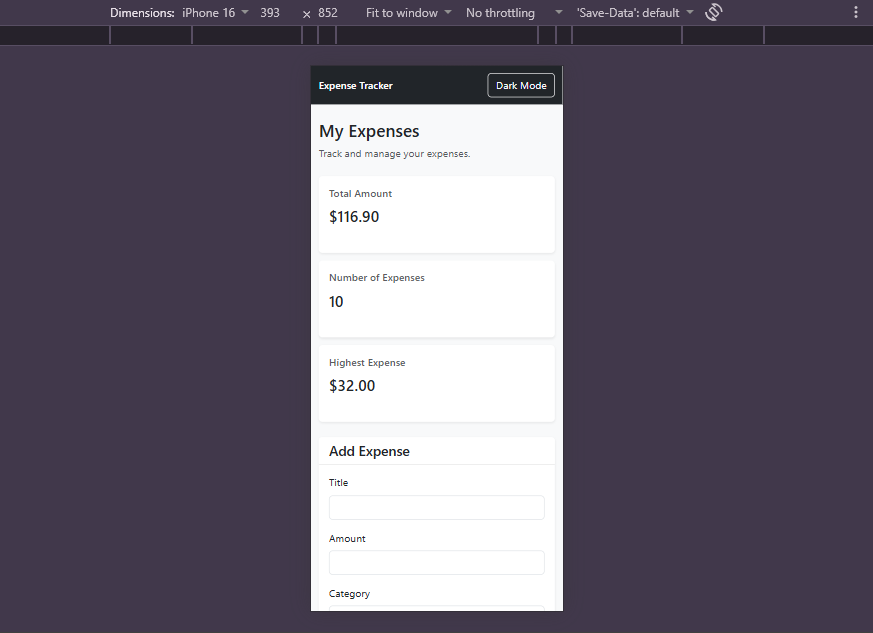

# Expense Tracker

Expense Tracker is a full-stack web application for managing personal expenses.
Users can add, view, edit, delete, filter, and search expenses, with all data stored in a PostgreSQL database.

## How to run

**Backend**

1. Open PostgreSQL using pgAdmin.
2. Create a database named "expense_tracker".
3. Open the schema.sql file from the backend folder.
4. Run the SQL code inside the expense_tracker database.
5. Open the terminal inside the backend folder.
6. Install the required packages: npm install express cors pg dotenv
7. Create a .env file inside the backend folder.
8. Add the following:
DB_HOST=localhost
DB_PORT=5432
DB_USER=postgres
DB_PASSWORD=your_password_here
DB_NAME=expense_tracker
 9. Replace your_password_here with your PostgreSQL password.
10. Start the backend:
node server.js

11. The backend will run on:
http://localhost:3000

**Frontend**

1.Open the frontend folder.
2.Open index.html using the VS Code Live Server extension.
3.Make sure the backend server is running before using the application.

## Features

- [✓] Add an expense (with validation)
- [✓] Delete an expense
- [✓] Edit an expense
- [✓] Filter by category
- [✓] Summary cards (total, count, highest)
- [✓] Data is saved in a PostgreSQL database
- [✓] Search expenses by title
- [✓] Responsive design
- [✓] CSS Grid for summary cards

## Screenshots

## What was the hardest part?

The hardest part was connecting the frontend to the backend API and making sure that adding, editing, and deleting expenses worked correctly with the PostgreSQL database. I solved this by using fetch with async/await, handling errors with try/catch, and loading the expenses again from the server after each operation
